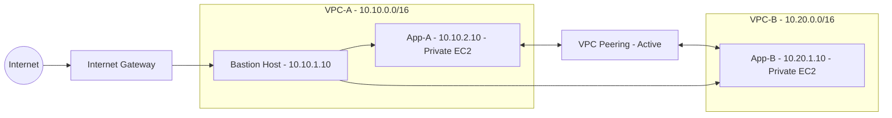

# AWS VPC Peering with Bastion Host and Private EC2 Instances

## Project Overview

This project demonstrates how to establish private network connectivity between two Amazon Virtual Private Clouds (VPCs) using VPC Peering. It uses a Bastion Host for SSH access to private EC2 instances and security groups to control network traffic.

The infrastructure was created in the AWS Asia Pacific (Sydney) Region (`ap-southeast-2`).

## Project Report

[Download the EWB VPC Peering Project Report (PDF)](./PiyushSingh_EWB_VPC_Peering_Final_Report_Fixed.pdf)

## Architecture

The project consists of two VPCs connected through an active VPC Peering connection. A Bastion Host in VPC-A provides an SSH entry point to the private EC2 instances in both VPCs.

### VPC-A

- **CIDR block:** `10.10.0.0/16`
- **Public subnet:** `10.10.1.0/24`
- **Private subnet:** `10.10.2.0/24`
- **Bastion Host private IP:** `10.10.1.10`
- **App-A private IP:** `10.10.2.10`

### VPC-B

- **CIDR block:** `10.20.0.0/16`
- **Private subnet:** `10.20.1.0/24`
- **App-B private IP:** `10.20.1.10`

### Connectivity

- VPC-A and VPC-B are connected through VPC Peering.
- App-A and App-B communicate using their private IPv4 addresses.
- The Bastion Host provides an SSH entry point to the private EC2 instances.
- App-A and App-B do not require public IP addresses for inter-VPC communication.

## AWS Services Used

- Amazon VPC
- VPC Peering
- Amazon EC2
- Subnets and route tables
- Internet Gateway
- Security Groups
- Network ACLs
- Amazon Linux 2023
- SSH and ICMP connectivity testing

## Routing Configuration

The route tables were configured to support local VPC communication, Internet access for the public subnet, and private communication between the two VPCs.

| Route table | Destination CIDR | Target |
|---|---|---|
| RT-A-Public | `10.10.0.0/16` | Local |
| RT-A-Public | `10.20.0.0/16` | VPC Peering |
| RT-A-Public | `0.0.0.0/0` | Internet Gateway |
| RT-A-Private | `10.10.0.0/16` | Local |
| RT-A-Private | `10.20.0.0/16` | VPC Peering |
| RT-B-Private | `10.20.0.0/16` | Local |
| RT-B-Private | `10.10.0.0/16` | VPC Peering |

The VPC Peering connection is active, and the relevant routes are configured in the route tables associated with the intended subnets.

## Security Configuration

Security groups control traffic to and from the EC2 instances.

- The Bastion Host accepts SSH connections according to its configured inbound rules.
- App-A permits SSH access from the Bastion Host's private IP address.
- App-B permits SSH access from the Bastion Host's private IP address.
- ICMP security group rules control ping traffic between the application instances.
- App-A and App-B use private IP addresses for inter-VPC communication.

During troubleshooting, a temporary broader inbound ICMP rule was added to App-A's security group to restore reverse ping connectivity. Security group rules should be reviewed and restricted to the minimum required traffic before production use.

## Testing and Results

### 1. App-A to App-B

- **Source:** `10.10.2.10`
- **Destination:** `10.20.1.10`
- **Result:** 4 packets received out of 4
- **Packet loss:** 0%

### 2. App-B to App-A

- **Source:** `10.20.1.10`
- **Destination:** `10.10.2.10`
- **Result:** 4 packets received out of 4 after restoring the broader ICMP rule
- **Packet loss:** 0%

### 3. SSH Through the Bastion Host

SSH access to App-A and App-B through the Bastion Host was verified. App-B was accessed using its private IP address without assigning it a public IP address.

### 4. Controlled ICMP Failure and Recovery

The controlled failure test was performed from App-A (`10.10.2.10`) to App-B (`10.20.1.10`).

- **Failure test:** The inbound ICMP Echo request rule was temporarily removed from App-B's security group (`ewb-sg-app-b`), which permits ping requests from App-A (`10.10.2.10/32`). App-A then ran `ping -c 4 10.20.1.10`. The result was 100% packet loss.
- **Recovery test:** The ICMP rule was restored on App-B's security group. App-A repeated the same ping command and received four replies with 0% packet loss.
- **SSH access:** The SSH inbound rule was kept in place during the test.

Evidence: `screenshots/11-icmp-blocked.png` and `screenshots/12-icmp-restored.png`.

## Evidence and Screenshots

### Connectivity Tests

- [App-A to App-B ping success](screenshots/app-a-to-app-b-ping-success.png)
- [App-B to App-A ping success](screenshots/app-b-to-app-a-ping-success.png)
- [App-A to App-B connectivity test](screenshots/app-a-to-app-b-connectivity-test.png)
- [App-B to App-A connectivity test](screenshots/app-b-to-app-a-connectivity-test.png)

### Private Instance Access

- [App-B private IP and hostname](screenshots/app-b-private-access.png)

### Security Group Troubleshooting

- [ICMP blocked test](screenshots/icmp-blocked.png)
- [ICMP restored test](screenshots/icmp-restored.png)

These screenshots document private instance addressing, bidirectional connectivity, and ICMP failure-and-recovery testing.

## Key Learnings

- Creating and configuring VPCs and subnets
- Establishing VPC Peering connections
- Configuring route tables for private network connectivity
- Using a Bastion Host to access private EC2 instances
- Understanding security groups and network ACLs
- Troubleshooting ICMP connectivity
- Testing
