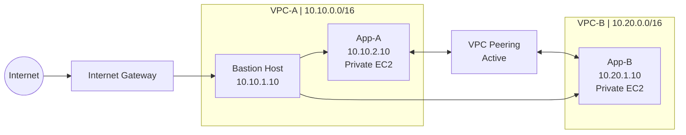

# AWS VPC Peering with Bastion Host and Private EC2 Instances

## Project Overview

This project demonstrates how to establish private network connectivity between two Amazon Virtual Private Clouds (VPCs) using VPC Peering. It uses a Bastion Host for secure SSH access to private EC2 instances and security groups to control network traffic.

The infrastructure was created in the AWS Asia Pacific (Sydney) Region (`ap-southeast-2`).

## Architecture

The project consists of two VPCs connected through an active VPC Peering connection.

### VPC-A

- **CIDR block:** `10.10.0.0/16`
- **Public subnet:** `10.10.1.0/24`
- **Private subnet:** `10.10.2.0/24`
- **Bastion Host:** `10.10.1.10` (public IPv4 address assigned)
- **App-A:** `10.10.2.10` (private IPv4 address)

### VPC-B

- **CIDR block:** `10.20.0.0/16`
- **Private subnet:** `10.20.1.0/24`
- **App-B:** `10.20.1.10` (private IPv4 address)

### Connectivity

- VPC-A and VPC-B are connected through VPC Peering.
- App-A and App-B communicate using private IPv4 addresses.
- The Bastion Host provides an SSH entry point to the private instances.
- App-A and App-B do not require public IP addresses for inter-VPC communication.

## AWS Services Used

- Amazon VPC
- VPC Peering
- Amazon EC2
- Subnets and route tables
- Internet Gateway
- Security Groups
- Network ACLs
- Amazon Linux 2023
- SSH and ICMP connectivity testing

## Routing Configuration

The route tables contain the following routes:

| Route table | Destination CIDR | Target |
|---|---|---|
| RT-A-Public | `10.10.0.0/16` | Local |
| RT-A-Public | `10.20.0.0/16` | VPC Peering |
| RT-A-Public | `0.0.0.0/0` | Internet Gateway |
| RT-A-Private | `10.10.0.0/16` | Local |
| RT-A-Private | `10.20.0.0/16` | VPC Peering |
| RT-B-Private | `10.20.0.0/16` | Local |
| RT-B-Private | `10.10.0.0/16` | VPC Peering |

The peering connection is active, and both private route tables are associated with their intended subnets.

## Security Configuration

Security groups control traffic to the EC2 instances.

- The Bastion Host accepts SSH connections according to its configured inbound rules.
- App-A permits SSH from the Bastion Host's private IP address.
- App-B permits SSH from the Bastion Host's private IP address.
- ICMP rules control ping traffic between the application instances.
- The application instances use private IP addresses for inter-VPC communication.

The ICMP failure-and-recovery test used a temporary broader inbound ICMP rule on App-A. The final configuration should be reviewed and restricted to the minimum required traffic before production use.

## Testing and Results

### 1. App-A to App-B

- Source: `10.10.2.10`
- Destination: `10.20.1.10`
- Result: 4 packets received out of 4
- Packet loss: 0%

### 2. App-B to App-A

- Source: `10.20.1.10`
- Destination: `10.10.2.10`
- Result: 4 packets received out of 4 after restoring the broader ICMP rule
- Packet loss: 0%

### 3. SSH Through the Bastion Host

SSH access to App-A and App-B through the Bastion Host was verified. App-B was accessed using its private IP address without assigning it a public IP address.

### 4. ICMP Failure and Recovery

The inbound ICMP rule was temporarily removed from App-A's security group.

- **Failure test:** App-B sent four ping requests to App-A; none received a reply.
- **Recovery test:** After restoring the broader ICMP rule, App-B received four replies with 0% packet loss.

This demonstrated how security group rules affect connectivity between instances.

## Evidence and Screenshots

The following screenshots document the implementation and connectivity tests.

### Connectivity Tests

- [App-A to App-B ping success](screenshots/app-a-to-app-b-ping-success.png)
- [App-B to App-A ping success](screenshots/app-b-to-app-a-ping-success.png)

### Private Instance Access

- [App-B private IP and hostname](screenshots/app-b-private-access.png)

### Security Group Troubleshooting

- [ICMP blocked test](screenshots/icmp-blocked.png)
- [ICMP restored test](screenshots/icmp-restored.png)

Additional evidence, including VPC configuration, the active VPC Peering connection, route tables, security group rules, and SSH access through the Bastion Host, can be added as further screenshots.

## Key Learnings

- Creating and configuring VPCs and subnets
- Establishing VPC Peering connections
- Configuring routes for private network connectivity
- Using a Bastion Host to access private EC2 instances
- Understanding the role of security groups and network ACLs
- Troubleshooting ICMP connectivity
- Testing controlled network failure and recovery
- Documenting cloud infrastructure using GitHub

## Security Notes

- Private EC2 instances do not need public IP addresses for VPC Peering communication.
- SSH access should be restricted to trusted sources.
- Security group rules should follow the principle of least privilege.
- AWS private keys, access keys, passwords, and other credentials must never be committed to this repository.

## Project Status

The VPC Peering connection, routing configuration, Bastion Host access, bidirectional ping tests, and ICMP failure-and-recovery demonstration have been tested.

The repository documentation and supporting screenshots are being organized for project submission.

---

**Project:** AWS VPC Peering with Bastion Host and Private EC2 Connectivity  
**Region:** Asia Pacific (Sydney) — `ap-southeast-2`  
**Platform:** Amazon Web Services (AWS)

